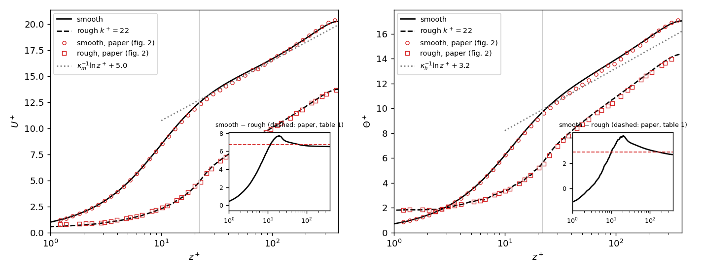

# Turbulent heat transfer over egg-carton roughness (MacDonald et al. 2019)

Validation case for the immersed boundary method (IBM) of CaNS-IBM: turbulent forced convection in a channel with
three-dimensional sinusoidal ("egg-carton") roughness on both walls, compared with

> M. MacDonald, N. Hutchins & D. Chung, *Roughness effects in turbulent forced convection*,
> J. Fluid Mech. **861** (2019) 138–162, doi:10.1017/jfm.2018.900

The case is table 1, set A, full-span channel (L<sub>y</sub><sup>+</sup> = 1241). A smooth channel at the same Re<sub>τ</sub> is run as the
reference for the roughness function ΔU<sup>+</sup> and the temperature difference ΔΘ<sup>+</sup>.

## Set-up

| | rough channel | smooth channel |
|---|---|---|
| Re<sub>τ</sub> = u<sub>τ</sub>h/ν | 395 | 395 |
| wall | z<sub>w</sub> = k cos(2πx/λ) cos(2πy/λ), both walls, same phase | flat |
| roughness | k = h/18 (k<sup>+</sup> = 21.9), λ = 7.07k (λ<sup>+</sup> = 155) | – |
| domain L<sub>x</sub> × L<sub>y</sub> | 16λ × 8λ = 2πh × πh (2482 × 1241 wall units) | same |
| L<sub>z</sub> | 2h + 2k (trough to trough) | 2h |
| grid | 512 × 256 × 480 | 512 × 256 × 240 |
| Δx<sup>+</sup> = Δy<sup>+</sup> | 4.85 (as in the paper) | 4.85 |
| Δz<sup>+</sup> | `gtype = 5`: 0.35 up to the crest, then geometric growth to 6.9 at the centre | same |

h is the half-height measured from the roughness **mean height** to the centre (the hydraulic half-height, as in the
paper). In CaNS-IBM the solid fills the box up to z<sub>w</sub>: with `ibm_shape = 'macdonald'` the lower wall is
`l_0 + amp (1 + cos cos)` and the upper wall `L_z − amp (1 − cos cos)`, so the mean heights are at z = k and z = L<sub>z</sub> − k,
2h = 2 apart. All lengths are in units of h, velocities in u<sub>τ</sub> (ν = 1/395).

Numerics: second-order IBM, `adv_form = 'vv'`, z-implicit diffusion with the IB inside the
operator (`is_impdiff = T, is_impdiff_1d = T`; needs `dims(2) = 1`), `ibm_proj = 'damped'` for the rough case.
The paper uses a body-fitted grid with N<sub>z</sub> = 320.

Scalar (temperature) as in the paper: Pr = 0.7 (`alphai = 276.5`), isothermal walls θ<sub>w</sub> = 0 (`cbcscal_ibm = 'D'`,
`bcscal_ibm = 0`), and the mean streamwise gradient applied as the source G = −u dT/dx (`const_scal = F`,
`scal_mean_grad = −1`). The heat added by the source leaves through the walls, so the wall heat flux per plan area and
wall is q<sub>w</sub> = U<sub>b</sub>h, and Θ<sub>τ</sub> = q<sub>w</sub>/u<sub>τ</sub>.

Forcing: a spin-up at constant bulk velocity (U<sub>b</sub><sup>+</sup> = 10.5 rough, intrinsic; 17.4 smooth), then a restart with a constant
pressure gradient Π = 1 (`bforce = 1`, `is_forced = F`). With h = 1 this gives u<sub>τ</sub> = 1, so Re<sub>τ</sub> = 395 exactly.
In the reference run, the wall drag from `data/ibm_force.out` gives u<sub>τ</sub> = 1.002 (lower wall) and 0.999 (upper wall).

## Files

| file | content |
|---|---|
| `inputs/rough_1_spinup_cfr.nml` | rough channel, spin-up from the log-law initial field at constant bulk velocity |
| `inputs/rough_2_stats_cpg.nml` | rough channel, restart at constant pressure gradient, statistics |
| `inputs/smooth_1_spinup_cfr.nml`, `inputs/smooth_2_stats_cpg.nml` | the same for the smooth channel |
| `make_input.py` | generator of the input files above, e.g. for other sizes or decompositions |
| `run_horeka.sh` | SLURM job script used for the reference runs (1 node, 4 × A100) |
| `mac_analyse.py` | time- and plane-averaged profiles and bulk quantities from `data/` |
| `mac_compare.py` | comparison with the paper (table of numbers, figure) |
| `mac_wall.py` | phase-averaged wall shear stress and wall pressure over one roughness element, from `FV-fric_*` |
| `reference/present_rough.dat`, `reference/present_smooth.dat` | mean profiles of the reference runs |
| `reference/macdonald2019_fig2_digitised.dat` | the paper's full-span profiles (figure 2), digitised |
| `reference/present_vs_paper.png` | figure produced by `mac_compare.py` for the reference runs |

`make_input.py <rough|smooth> <cfr|cpg> [key=value ...]` writes the namelist to standard output; keys are
`nx, ny, nz, nlx, nly` (domain in wavelengths λ), `ndims` (number of ranks), `restart`, `tmax`, `twmax` (hours), `iout0d`,
`iout1d`, `iout2d`, `iout3d`, `isave`, `iwall` (`ibm_iout_wall`), `cfl`, `nstep`. The four files in `inputs/` are
reproduced exactly by

```
python3 make_input.py rough  cfr twmax=0.7  iout1d=500  isave=2000              > rough_1_spinup_cfr.nml
python3 make_input.py rough  cpg twmax=47.5 iout1d=2000 isave=20000 restart=T   > rough_2_stats_cpg.nml
python3 make_input.py smooth cfr twmax=0.7  iout1d=500  isave=2000              > smooth_1_spinup_cfr.nml
python3 make_input.py smooth cpg twmax=11.8 iout1d=2000 isave=20000 restart=T   > smooth_2_stats_cpg.nml
```

A small laptop test (one GPU, about 1 M points): `python3 make_input.py rough cfr nx=64 ny=32 nlx=4 nly=2 ndims=1 tmax=1`.

## How to run

1. Build CaNS-IBM for GPUs (`make libs && make` with `FCOMP=NVIDIA`, `GPU=1`; see the main README).
2. Rough channel, in an empty run directory:
   ```
   cp inputs/rough_1_spinup_cfr.nml input.nml
   mpirun -n 4 <path>/build/cans          # spin-up; tw_max = 0.7 h writes the restart files at the end
   cp inputs/rough_2_stats_cpg.nml input.nml
   mpirun -n 4 <path>/build/cans          # statistics; resubmit with restart = T to extend
   ```
   On HoreKA: `CANS_DIR=<checkout> sbatch -A <project> -p accelerated -t 48:00:00 run_horeka.sh <run dir>`.
3. The same for the smooth channel with the `smooth_*` inputs.
4. Analysis, discarding the transient (the reference runs use step 150 000, t ≈ 40 h/u<sub>τ</sub>):
   ```
   python3 mac_analyse.py <rough run dir>  rough  150000 --out rough.npz
   python3 mac_analyse.py <smooth run dir> smooth 150000 --out smooth.npz
   python3 mac_compare.py rough.npz smooth.npz present_vs_paper.png
   ```

Notes:
- The per-point wall outputs (`fric-*`, `pressure*`, `FV-fric_*`, wall-stress map) are off (`ibm_iout_wall = 0`).
  At this size one snapshot of them is about 4.4 GB of text (2.1 GB of it `FV-fric`), and their set-up costs several
  minutes. Set `ibm_iout_wall` to a positive interval for a few snapshots (see *Local wall stress and pressure*).
- `turb_stats_ibm_<step>.out` (intrinsic averages and fluid fractions) and `scal_01_mean_fld_<step>.out`
  (superficial scalar mean) are plane averages of single snapshots, written every `iout1d` steps; `mac_analyse.py`
  averages them in time and folds the two halves of the channel.
- The restart files (`data/fld_*.bin`, 2.5 GB for the rough channel, single precision) are not included.

## Cost of the reference runs

HoreKA, one node with 4 × A100-40GB, nvhpc 24.9, one rank per GPU (`dims = 4, 1`):

| | points | s per step | Δt (CFL 0.95) | run |
|---|---|---|---|---|
| rough | 126 M | 0.08–0.12 | ≈ 2.1·10⁻⁴ h/u<sub>τ</sub> | t = 562 h/u<sub>τ</sub>, 2.14 M steps, 48 h |
| smooth | 31 M | 0.036 | ≈ 4–5·10⁻⁴ h/u<sub>τ</sub> | t = 630 h/u<sub>τ</sub>, 1.28 M steps, 11.8 h |

## Reference results

Statistics over t = 40–562 h/u<sub>τ</sub> (rough, 997 samples) and t = 40–630 h/u<sub>τ</sub> (smooth, 566 samples). Splitting
each window in two halves changes ΔU<sup>+</sup> and ΔΘ<sup>+</sup> by 0.01–0.04.

| quantity | present | MacDonald et al. (2019) |
|---|---|---|
| ΔU<sup>+</sup> at the centre | 6.51 | 6.7 (table 1) |
| ΔU<sup>+</sup>, mean over 50 < z<sup>+</sup> < 355 | 6.60 | ≈ 6.7 (figure 2) |
| ΔΘ<sup>+</sup> at the centre | 2.68 | 2.9 (table 1) |
| ΔΘ<sup>+</sup>, mean over 50 < z<sup>+</sup> < 355 | 2.96 | ≈ 3 (figure 2) |
| U<sub>b</sub><sup>+</sup> rough | 11.12 | 11.06 from the figure 2 profile (see below) |
| U<sub>b</sub><sup>+</sup> smooth | 17.67 | ≈ 17.7 from the figure 2 profile |
| U<sub>k</sub><sup>+</sup> = U<sup>+</sup>(z = k), at the crest | 4.85 | ≈ 4.7 (fully rough cases, figure 4c) |
| Θ<sub>k</sub><sup>+</sup> = Θ<sup>+</sup>(z = k) | 5.60 | – |
| Θ<sub>m</sub><sup>+</sup> (mixed mean), rough / smooth | 12.62 / 15.25 | – |
| C<sub>f</sub> = 2/U<sub>b</sub><sup>+2</sup>, rough / smooth | 0.0162 / 0.0064 | figure 7 |
| C<sub>h</sub> = 1/(U<sub>b</sub><sup>+</sup>Θ<sub>m</sub><sup>+</sup>), rough / smooth | 0.0071 / 0.0037 | figure 7 |
| 2C<sub>h</sub>/C<sub>f</sub>, rough / smooth | 0.88 / 1.16 | figure 7 |

Profiles, paper minus present, averaged over bands of the digitised curves (read accuracy about ±0.1):

| z<sup>+</sup> | U<sup>+</sup> smooth | U<sup>+</sup> rough | Θ<sup>+</sup> smooth | Θ<sup>+</sup> rough |
|---|---|---|---|---|
| 1–10 | 0.00 | +0.16 | −0.01 | −0.03 |
| 10–40 | −0.16 | −0.01 | −0.18 | −0.09 |
| 40–120 | −0.12 | −0.08 | −0.22 | −0.20 |
| 120–250 | +0.05 | −0.08 | −0.05 | −0.12 |
| 250–395 | +0.14 | −0.09 | +0.06 | −0.16 |



Summary:
- **Agreement.** The mean velocity and temperature of both channels agree with the paper to about 0.2 wall units
  everywhere, including below the crest. The difference profiles have the paper's shape: a peak near the crest
  (ΔU<sup>+</sup> ≈ 7.7, ΔΘ<sup>+</sup> ≈ 4.2 at z<sup>+</sup> ≈ 20), then ΔU<sup>+</sup> nearly constant above z<sup>+</sup> ≈ 40, and ΔΘ<sup>+</sup> relaxing outward.
- **Offset.** At the centre, ΔU<sup>+</sup> and ΔΘ<sup>+</sup> are about 0.2 below table 1. The cause is the outer region of the rough
  channel, where the present U<sup>+</sup> and Θ<sup>+</sup> are 0.1–0.16 above the paper's; the smooth channel agrees there. This is
  about twice the paper's stated uncertainty in ΔU<sup>+</sup> (0.1), and of the size of the paper's own spread between
  span widths (6.5–6.8). The possible causes have not been separated: the Cartesian IB grid against the paper's
  body-fitted grid, and the averaging time.
- **Bulk velocity.** The paper defines U<sub>b</sub><sup>+</sup> = (1/h)∫₀ʰ U<sup>+</sup> dz, with z and h from the roughness mean height and
  intrinsic averages below the crest. This gives 11.15 here; the superficial flow rate divided by 2h, which
  `mac_analyse.py` reports, gives 11.12. Table 1's U<sub>bf</sub><sup>+</sup> = 10.5 is not this integral. It is an "expected full-span"
  value from a composite profile (Nagib & Chauhan 2008) fitted to the data (paper §§2 and 4.2). The paper's own
  full-span profile in figure 2 integrates to about 11.06. Compare the profiles, ΔU<sup>+</sup> and ΔΘ<sup>+</sup>, not U<sub>bf</sub><sup>+</sup>.

## Local wall stress and pressure

A restart of the rough run with the per-cell wall force on (`make_input.py rough cpg restart=T twmax=1.9 iout1d=2000
isave=1000000 iwall=2000`, 2 h on HoreKA) writes 34 snapshots of `FV-fric_*` over t = 563–580 h/u<sub>τ</sub>, then

```
python3 mac_wall.py <run dir> --out wall.npz      # add --dtlog <log> for output of builds before e7e9133
```

splits the force of each cut cell into its normal (pressure) and tangential (viscous) parts, averages them over the
cut cells of each (x, y) column, and phase-averages over the 128 elements of both walls (32 × 32 columns per element).
The result is in `reference/present_wall_element.dat`.

| quantity | present | MacDonald et al. (2019) |
|---|---|---|
| drag per wall and plan area, F<sub>T</sub>/(ρu<sub>τ</sub><sup>2</sup>A) | 0.994 | 1 by definition |
| pressure drag F<sub>p</sub>/F<sub>T</sub> | 0.576 | ≈ 0.55 (figure 8a, k<sub>s</sub><sup>+</sup> ≈ 90) |
| C<sub>dk</sub> = 2/U<sub>k</sub><sup>+2</sup> | 0.085 | ≈ 0.09 (figure 8b) |
| plan area with mean τ<sub>x</sub> < 0 | 42 % | – |
| peak τ<sub>x</sub><sup>+</sup> (just upstream of the crest) | 3.6 | – |
| wall pressure, p<sub>w</sub><sup>+</sup> − ⟨p<sub>w</sub><sup>+</sup>⟩ | +4.5 windward face, −6.4 crest top | – |

The paper shows wall shear maps only for larger roughness (figure 9, k<sup>+</sup> ≈ 33 and 93). The reference snapshots
were written before the fix e7e9133 (on steps that are multiples of `icheck` the per-cell force used the time step of
the next step) and were rescaled with `--dtlog`; each snapshot's lower-wall total then matches the exact wall-stress
map `ibm_wall_stress_*.out` to 0.1 %.

### Columns of `reference/present_*.dat`

z<sup>+</sup> (rough: from the roughness mean height, negative below it), U<sup>+</sup>, Θ<sup>+</sup>, ⟨u′u′⟩<sup>+</sup>, ⟨v′v′⟩<sup>+</sup>, ⟨w′w′⟩<sup>+</sup>,
⟨u′w′⟩<sup>+</sup>, fluid fraction at the u nodes, fluid fraction at the cell centres. Lower half of the channel, both halves
folded. The averages are intrinsic (over the fluid only), and the header lists the bulk quantities.
